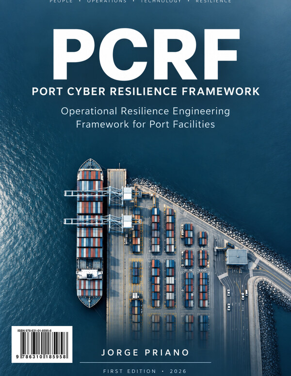

# PCRF — Port Cyber Resilience Framework

**Operational Resilience Engineering Framework for Port Facilities**
v1.0 · 1.ª edición especial, 2026 · Autor: Jorge Priano · **ISBN 978-631-01-8595-8**

Marco metodológico para la resiliencia operacional ciber-física de instalaciones portuarias: funciones portuarias críticas, dependencias, traspaso ciber-físico entre IT/OT y protección, modos degradados, contención, retorno a la normalidad y evaluación basada en evidencia (definido · implementado · probado).

<p align="center">
  <a href="https://github.com/jpriano/port-cyber-resilience-framework/releases/latest/download/PCRF-v1.0.pdf">
    
  </a>
</p>

## Descargar el libro

**[⬇ Descargar PCRF v1.0 (PDF, 257 páginas, 1,8 MB)](https://github.com/jpriano/port-cyber-resilience-framework/releases/latest/download/PCRF-v1.0.pdf)**

También disponible en la página de la [versión v1.0 con ISBN](https://github.com/jpriano/port-cyber-resilience-framework/releases/tag/v1.0-isbn) y como [archivo en este repositorio](PCRF-v1.0.pdf).

Verificación de integridad (SHA-256):

```
3a4d31f7805a74a30b2d37e01e3d2daa79230d69dc2aaa04ba13ddc720fa5b99  PCRF-v1.0.pdf
```

## Cómo citar

> Priano, J. (2026). *PCRF — Port Cyber Resilience Framework: Operational Resilience Engineering Framework for Port Facilities* (1.ª ed. especial). ISBN 978-631-01-8595-8.

## Licencia

El contenido original de esta obra se distribuye bajo **Creative Commons Atribución-NoComercial 4.0 Internacional (CC BY-NC 4.0)**. El uso comercial requiere autorización expresa y previa del autor. La licencia no se extiende a las citas, extractos y traducciones de fuentes de terceros reproducidas en el libro. Ver [LICENSE.md](LICENSE.md) y la página legal del libro.

## Descargo de responsabilidad

PCRF se ofrece "tal cual", sin garantía de ningún tipo. No sustituye asesoramiento legal, regulatorio o profesional, no garantiza el cumplimiento de ninguna norma ni un resultado de seguridad específico. El estado de validación empírica se documenta en el Anexo I del libro. Ver el descargo completo en la página legal del libro.
